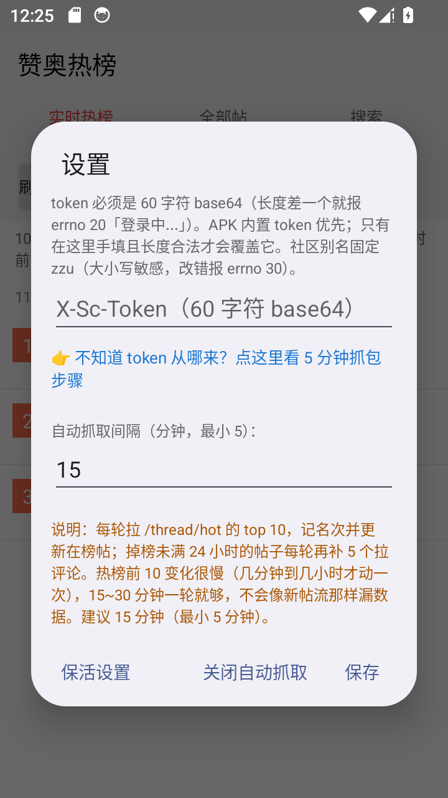
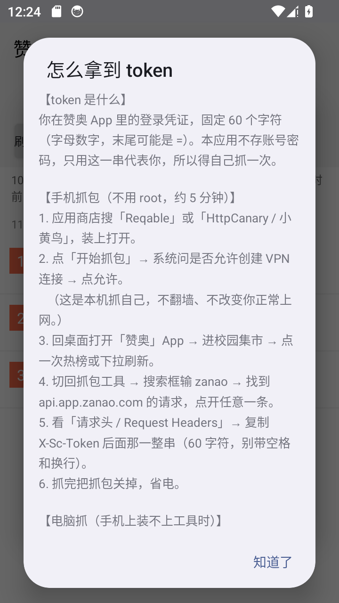

# 零基础使用指南（不用会编程）

这份文档写给「只想装上用」的人：不装 Android Studio、不碰命令行，从下载 APK 到自动抓取全部走完。
想改代码再看 [README](../README.md) 的构建章节。

---

## 0. 这个 App 到底帮你做什么

赞奥校园集市（郑州大学 cid=`zzu`）的**热榜 10 条**，连同每条的**正文、全部评论、全部图片、每一轮的名次变化**，全部存进你手机本地的 SQLite 数据库。

它做的事等价于：每 15 分钟替你打开一次热榜，把看到的东西一字不落地记下来，就算帖子后来被删、评论被改，你手机里的原话也还在。

三个页签：

| 页签 | 里面是什么 |
| --- | --- |
| 实时热榜 | 最新一轮抓到的前 10 名（数字是名次，下面是热度/浏览/评论/赞） |
| 全部帖 | 所有上过榜的帖子，按发帖时间倒序，能一直往下翻 |
| 搜索 | 在自己攒下来的全部帖子里搜标题和正文，红色那行是命中的正文摘录 |

---

## 1. 你需要准备什么

1. 一台 **Android 7.0 以上**的手机
2. 装好官方「**赞奥**」App 并**登录自己的账号**（用来取 token，本 App 不存你的账号密码）
3. 手机上有装 APK 的权限（设置里允许「安装未知来源应用」）

> 本 App 没有登录界面，也不保存账号密码。它只认一串 60 字符的 **token**——也就是官方 App 里的登录凭证。所以第一次用必须先拿到 token，见第 3 节。

---

## 2. 第一步：装 APK

1. 从仓库的 `dist/` 里下载 `zanao_hot_1.3.4.apk`（约 378 KB）
2. 传到手机上（微信/QQ 发给自己、数据线、网盘都行）
3. 点开安装，系统提示「未知来源」→ 去设置允许 → 返回继续装
4. 桌面出现「赞奥热榜」，打开

已经装过旧版的直接覆盖安装即可（同签名，数据保留）。

---

## 3. 第二步：拿到 token（唯一有门槛的一步）

### 3.1 先理解它是什么

官方 App 每次请求 `api.app.zanao.com` 时，都会在**请求头**里带一行：

```
X-Sc-Token: cG8rSG1QTGJ5QXJpejhtYi8……
```

这一串就是你的登录状态，**固定 60 个字符**（字母数字，末尾可能有个 `=`）。
本 App 没法和赞奥服务器要这个值，只能你自己从官方 App 的流量里「抄」一次。抄完存进手机，之后一直用它。

所以做法就是：**装个抓包工具，抓一次官方 App 的请求，把 `X-Sc-Token` 复制出来。**

### 3.2 手机抓包（推荐，不用 root，约 5 分钟）

以 **Reqable** 为例（**HttpCanary / 小黄鸟**、**Stream** 操作几乎一样）：

1. 应用商店或官网装 **Reqable**，打开
2. 点右下角「**开始抓包**」→ 系统弹出「是否允许创建 VPN 连接」→ **允许**
   （这是本机自己抓自己，不翻墙、不改变你正常上网；抓完关掉即可）
3. 按 Home 键回桌面 → 打开官方「**赞奥**」App → 进校园集市 → **点一次热榜或下拉刷新**
   （这一步是为了让它发出请求，不然抓不到东西）
4. 切回 Reqable → 顶部搜索框输 `zanao` → 列表里找域名是 **`api.app.zanao.com`** 的请求 → **点开任意一条**
5. 切到「**请求头 / Request Headers**」→ 找到 **`X-Sc-Token`** → 长按复制那一整串（60 字符，**别带空格、别带换行**）
6. 复制完把抓包**关掉**，省电

> 抓不到 `api.app.zanao.com`？
> · 确认点了「开始抓包」并且 VPN 授权给了
> · 回赞奥 App 里真的刷了一下热榜
> · 换 Stream 或 HttpCanary 再试；个别系统的 VPN 抓包会被安全软件拦

### 3.3 电脑抓包（手机上装不上工具时）

1. 手机和电脑连**同一个 WiFi**
2. 电脑上装 Python 后执行 `pip install mitmproxy`，再运行 `mitmproxy`
3. 手机：设置 → WiFi → 当前网络 → 代理改成**手动**：主机填电脑的**内网 IP**，端口填 `8080`
4. 手机打开赞奥 App，刷一下热榜
5. 电脑窗口里按 `/` 搜 `zanao` → 选中 `api.app.zanao.com` 的请求 → 右侧 **Request Headers** 里复制 `X-Sc-Token`
6. 抓完把手机代理改回「无」

> **不用装证书**。这个接口是 `http` 明文（不是 https），所以比一般抓包教程少一步。
> 用完记得关代理，否则断开电脑后手机会上不了网。

### 3.4 别的方式

同校同学已经抓过并验证有效的 token，直接给你用也行——但它跟着**对方的账号**，对方退出登录/换设备就失效，而且请求会计在对方头上。**不建议长期这么干。**

拿到 token 之后请像密码一样对待它：别发群里、别截图带出去。

---

## 4. 第三步：填 token 并验证

1. 打开「赞奥热榜」→ 点顶部按钮行的「**设置**」
2. 把 token 粘进 **X-Sc-Token** 输入框（不知道从哪来可以点下面那行蓝色字，有内置图文步骤）
3. 抓取间隔默认 **15 分钟**（最小 5），别改太小
4. 点「**保存**」
5. 回首页点「**刷新**」

**成功的样子**：顶部出现「`MM-dd HH:mm 抓取 · 当前在榜`」和 10 条帖子，底部状态栏显示「上次抓取 0 分钟前」。

**失败对照表**（提示原文都写在界面上）：

| 提示 | 意思 | 怎么办 |
| --- | --- | --- |
| `未登录（errno 20）` | token 不对 | 长度不是 60、复制时多了空格或换行、token 已失效 → 重新抓一次 |
| `未知的社区（errno 30）` | 社区别名不对 | 本 App 固定 `zzu`，一般不会遇到 |
| `请求被拒（errno 10：用户本地网络异常）` | 手机时间不准 | 打开「自动设置日期时间」再试 |
| `签名校验失败（errno 6）` | 请求头被改坏 | 不要用代理工具二次改请求，关掉再试 |
| `网络失败：xxx` | 连不上 | 校园网没认证 / 手机没网 / 残留代理 |

---

## 5. 第四步：让它自己抓（关键，90% 的人卡在这）

安卓会杀后台。不设置的话，你锁屏过一会儿抓取就停了，表现就是「只能手动」。

打开 App 时如果弹「**让本应用在后台持续运行**」，点「**去授权**」→ 选**允许**。

然后按你的手机品牌做一次（一次性设置，之后不用管）：

| 品牌 | 路径 |
| --- | --- |
| 小米 / 红米 | 设置 → 应用设置 → 赞奥热榜 → **省电策略 → 无限制**；再开 **允许自启动**；任务管理器里给本应用**加锁** |
| 华为 / 荣耀 | 设置 → 应用 → 赞奥热榜 → **耗电管理 → 手动管理**（三个开关全开）；应用启动管理设为手动 |
| OPPO / 一加 / realme | 设置 → 电池 → 更多 → 赞奥热榜 → **允许后台运行** + 允许自启动 |
| vivo / iQOO | 设置 → 电池 → 后台耗电管理 → 赞奥热榜 → **允许后台高耗电** |
| 三星 | 设置 → 电池 → 后台使用限制 → 把赞奥热榜**移出休眠应用** |
| 原生 Android / 模拟器 | 无需额外设置 |

设置里点「**保活设置**」可以随时查看当前状态：电池白名单是否已允许、常驻服务是否在跑、各品牌该去哪儿点。

**不要关它的通知。** 通知栏常驻的那条「赞奥热榜 · 正在后台抓取」是前台服务，安卓靠它才不杀进程。嫌烦可以静音，但别划掉。

**怎么确认它真的在跑**：锁屏放 20 分钟，回来打开 App 看底部「上次抓取 X 分钟前」——数字会自己变小说明正常。也可以下拉通知栏看那条通知还在不在。

---

## 6. 日常使用

- **刷新**：立刻抓一轮（手动抓也会标成「手动」，不影响数据）
- **统计**：看一共攒了多少帖、多少评论、多少图片、多少条名次变化、当前还在追踪几个掉榜帖
- **导出**：存一个 zip 到手机（里面有数据库 + 全部图片），可以备份或换手机用
- **导入**：把导出的 zip 还原回来（会**覆盖**当前数据，导入前有确认弹窗）
- **搜索**：只搜你自己库里的内容，不联网

**换手机 / 重装**：先「导出」→ 新手机装 APK → 填 token → 「导入」选那个 zip。

---

## 7. 常见问题

**Q：为什么必须抓包，不能直接在 App 里输账号密码？**
赞奥的接口没有帐号密码登录接口能用（登录走的是 App 内部协议），所以本 App 只认 token。抓一次，以后一直用。

**Q：token 会过期吗？**
会。你在官方 App 退出登录、换设备登录、或者服务器清理会话时会失效，表现是 errno 20。重新抓一次就行。

**Q：装的时候提示「应用未安装 / 签名不一致」？**
你手机上还装着别人签名的旧版本。卸载旧的再装（数据会丢，所以先导出）。

**Q：抓取间隔设多少合适？**
15 分钟。热榜前 10 变化很慢（几十分钟到几小时才动一次），设 5 分钟没意义还费电、给服务器添麻烦。

**Q：抓到的数据会上传吗？**
不会。全部存在手机本地 `databases/zanao_hot.db` 和 `files/img/`，App 没有上传代码。只有「向赞奥服务器要热榜」这一个方向联网。

**Q：帖子被作者删了，我这儿还有吗？**
有。评论被删/被改，旧版本也会留一份（统计页能看到「X 条评论留了旧版」）。这是它的核心价值。

**Q：能不能抓别的学校？**
代码里 `Api.ALIAS = "zzu"` 是写死的，改源码重编译即可（见 README）。

**Q：会不会被抓到？**
抓的是公开可见的榜面数据，频率跟人手动刷差不多。别把间隔调成几秒钟就行。

**Q：帖子内容能随便发出去吗？**
不行。里面是别人的昵称、头像、发言。自己留档、做研究可以，二次公开发布要自己承担后果，也请尊重当事人。

---

## 8. 想自己改代码

仓库是纯 Java + aapt2，不需要 Gradle/Android Studio：

```powershell
$env:JAVA_HOME = "C:\Program Files\Eclipse Adoptium\jdk-25.0.4.101-hotspot"
.\build.ps1 -Sdk C:\android-sdk -Ks D:\keys\zanao.jks -KsPass 你的口令
```

细节（r37 构建工具、ASCII 路径、token 注入）看 [README](../README.md)。

---

## 9. 界面对照

| 设置页（token 填这里） | 内置的「怎么拿到 token」说明 |
| --- | --- |
|  |  |
